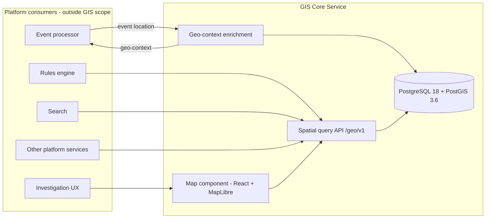

# GIS Core Service: Architecture

Status: MVP candidate 0.1.0 (migration head `20260924_0008`), validated in development on
25 September 2026 - not production-ready; see the [validation report](docs/validation.md). Data model,
geo-context enrichment, spatial query API, operational objects, security and multi-tenancy, the reference
data pipeline and releases, and the map client.
Source: *GIS Core Service - Project Implementation Plan* v0.9 (section references such as "plan §7" point
to it) and §8 "GIS as a core service" of the *Flock-like Open Platform Reference Architecture*.
Where this document and plan v0.9 disagree, this document wins; the differences are listed in
[Section 10](#10-changes-from-plan-v09).

---

## 1. Purpose

The GIS Core Service is the platform's geospatial intelligence component: service 4, "Geo-context", of
the reference architecture's seven reusable services. It:

* is the **authoritative spatial store** (PostgreSQL + PostGIS) for reference and operational geodata;
* **enriches events** with spatial facts (admin area, nearest settlement and road, zones and geofences
  hit, nearby devices);
* answers **spatial queries** for any platform component through a versioned HTTP API;
* manages **geofences** and **site / device placement**;
* provides the **map component** (React + MapLibre GL JS) that shows this data.

## 2. Service boundary: GIS only

### 2.1 What the service is responsible for

```
Event ──> GIS geo-context enrichment ──> geo-context (spatial facts attached to the event)

Clients / rules engine / investigation UX / other platform services
        ──> GIS spatial APIs ──> PostGIS
```

The service's output is **spatial intelligence**: facts and query results about geometry. It is not
responsible for what other services do with those facts.

### 2.2 Alert Service exclusion

The Alert Service is **removed from this implementation**. The GIS service must not:

| Excluded responsibility | Consequence for this codebase |
|---|---|
| Sending alerts | No alert entities, queues or delivery code |
| Orchestrating notifications | No escalation, acknowledgement or workflow state |
| Identifying notification recipients | Capability **S-08** (recipients within X m) is **not implemented**. The query API offers the generic `POST /geo/v1/query/within-distance` instead, which answers "which objects of this layer are within X m" - a caller can ask about settlements, devices or geofences, never about people |
| Storing user notification locations | The **notification-locations operational layer is removed**; there is no table, API or map layer for user locations |
| Notification channels (SMS, push, email, WhatsApp, voice or similar) | No channel integrations or dependencies |
| Alert orchestration logic | No rules about who is told what, or when |

Elements of plan v0.9 that were removed or redesigned because of this:

| Plan v0.9 element | Decision |
|---|---|
| §5.1 layer "Notification locations" | Removed |
| §6 S-08 "Recipients within X m" | Removed |
| §6 S-09 "Reverse geocoding ... for alert text" | Redesigned: S-09 is **reverse geocoding for geographic context** (admin area and nearest named place for a coordinate). It serves the investigation UX, the geo-context block and any other consumer, and carries no alert-message semantics |
| §7 `GET /geo/v1/reverse` (consumers "Alerts, UX") | Kept, redesigned: geographic context / reverse geocoding. Consumers: investigation UX, geo-context enrichment, other platform services |
| §7 `within-distance` and `nearest` (consumers "Rules, alerts, UX") | Kept as **generic spatial queries** over GIS-owned layers only (reference layers, sites, devices, geofences, response units). They never query people's locations |
| §4.2 step 5 "The alert service calls the API for recipients..." | Removed |
| §16 dependency "Alert service recipient lookup (W17)" | Removed |
| §17 Q6 "Notify users within 1 km" (opt-in locations or cell coverage) | Removed from GIS scope. If the platform needs it, the owning service designs it and may call the generic spatial APIs |
| §11.4 sprint S8 "recipient lookup (S-08) with privacy controls" | Removed |
| §9 row "Personal location data" | Narrowed to **response-unit positions** (S-05 "nearest response team"), which can still identify a person on duty: last-known only, expiring, access-logged |
| §3 traceability row for §13 "Alert orchestration" | Not applicable to GIS |

Guardrails that keep the boundary intact:

* **No outbound calls.** The GIS service does not call other platform services; it only answers
  requests and (from the Pilot phase) consumes and publishes events about spatial facts.
* **No people-location data.** Spatial queries operate on GIS-owned layers. A request to add a layer
  of individual people's positions needs an architecture decision, not a migration.
* **Consumer-neutral API.** Endpoint names, fields and documentation describe geometry
  (`distanceM`, `zones`, `geofenceHits`), not downstream intent (no "recipient", "notify" or "alert" fields).
* The OpenAPI description states the boundary, so every client sees it.

### 2.3 Other exclusions carried over from the plan

Cameras and edge processing, AI and VLM models, the vector database, rules-engine logic, the
investigation screens other than the map component, device-health pipelines, identity-provider
operation, correlation algorithms and road-network routing are owned elsewhere (plan §2.3).

## 3. Context



## 4. Components and delivery status

| ID | Component | Foundation release (this version) | Next |
|---|---|---|---|
| C1 | Spatial data store | Authoritative model: reference, operational and event tables with EPSG:4326 + EPSG:5235 twin geometries, validity and envelope constraints, GiST/BRIN indexes, row-level security, monthly event partitions, layer registry ([docs/database](docs/database/README.md)); append-only audit log with change and release triggers (migration 0007) | Response units (S-05), retention jobs (events, audit) |
| C2 | Reference data pipeline | Profile-driven ETL (`python -m app.pipeline`, Section 5.7): GDAL/ogr2ogr, GeoPandas, Shapely and pyproj; licences checked, never assumed; verified coordinate operations; full lineage per dataset; file QA and database QA (40 checks) with a publish gate and audited waivers; releases with a purpose (production, development, test); `GET /geo/v1/releases`; the development release `ref-2026.09-dev` from open data, committed as a sample | Official datasets (Survey Department, DWC, FD, RDA, Irrigation, NBRO, DMC) under agreement, with approved licence reviews |
| C3 | Geo-context enricher | Enrichment engine (Section 5.4): validation, one indexed lookup statement, deterministic `geo-context/1` document, storage with hits; `POST /geo/v1/enrich` | Event-stream consumer (NATS, Phase 2) |
| C4 | Spatial query API | FastAPI application, error model, `GET /geo/v1/service-area`, `POST /geo/v1/enrich` ([docs/api/enrichment.md](docs/api/enrichment.md)); layer catalogue and features, within-distance, nearest, containment, reverse geocoding, event queries, geofence, site and device-placement management ([docs/api/spatial-queries.md](docs/api/spatial-queries.md)) | Response units (S-05), tiles for large layers |
| C5 | Tiles and basemap | Basemap built by the pipeline from OpenStreetMap: one PMTiles file (z0-14, national with pilot-area detail), a MapLibre style and glyphs, recorded as release artifacts, served as static files at `/basemap` | Tiles for the heavy reference layers |
| C6 | Map component | Embeddable React + MapLibre client (Section 5.6): event, device, field-of-view, site, geofence and reference layers with visibility controls and a legend; event clustering, type and time filters; selection with a popup that resolves geographic context; radius search, nearby devices, a ruler in EPSG:5235 metres and draw-to-filter; a Terra Draw geofence editor for polygons, circles and corridors ([docs/frontend/map-client.md](docs/frontend/map-client.md)) | Aggregation and tiles for large layers, saved views |
| C7 | OGC gateway | - | Phase 3, only if external demand is confirmed |
| C8 | Cross-cutting | Structured logs, request IDs, Prometheus metrics, health and readiness probes, transaction-scoped tenant and actor context, RLS policies, the tenant each request acts for (`X-GIS-Tenant-Id`, else `GIS_TENANT_ID`; no credentials - the main platform owns sign-in, ADR-0019), audit log of searches, sensitive queries, exports and changes ([docs/security.md](docs/security.md)), keyset paging, request size limit | Sign-in checked in the platform's proxy, audit retention job |

## 5. Runtime view

### 5.1 Backend layering

```
backend/app/
  main.py            application factory (create_app); lifespan creates the engine and services
  api/               HTTP only: routers, dependency wiring and the caller (deps.py),
                     RFC 9457 error handlers
    health.py        /health/live, /health/ready
    v1/              /geo/v1 routers: service-area, layers, queries (+ reverse), events, geofences,
                     assets (sites, device placement), enrich (+ OpenAPI examples and problems)
  services/          use cases: readiness, reference data loading, releases; no HTTP types
    enrichment/      geo-context engine: validation, assembly (pure), service (transactions, storage)
    spatial_query.py layer catalogue, features, proximity, containment, reverse geocoding, events
    operational.py   geofence, site and device placement management (ownership, versions, retiring)
  repositories/      parameterised SQL (spatial lookups, queries, operational writes, events); no rules
  spatial/           CRS conventions, service area, GeoJSON validation, the layer registry (layers.py)
  db/                engine, transactional sessions with tenant context, declarative base
  core/              settings, logging, middleware, errors, tenancy, paging, the caller (caller.py)
  models/            ORM models mirroring the migrations (meta, reference, operational, events)
  schemas/           Pydantic models (camelCase on the wire): GeoJSON, events, geo-context, spatial
                     queries, operational objects, problems
  tools/             command-line tools (load_reference_data, register_tenant, seed_dev_data, benchmark)
```

Dependencies point inwards (api -> services -> repositories -> db). Long-lived objects are built once in
the lifespan and held in `AppContainer`; handlers receive them through typed `Annotated` dependencies,
which tests can override.

### 5.2 Request handling

1. `RequestContextMiddleware` (pure ASGI) accepts a well-formed `X-Request-ID` or creates one, returns
   it on every response, records metrics by **route template** (bounded label cardinality) and writes
   one access log line.
2. `BodySizeLimitMiddleware` rejects bodies above `GIS_MAX_REQUEST_BODY_BYTES` (declared or streamed)
   with 413 before they are parsed.
3. The caller is the main platform (`app.core.caller`), acting for the tenant in `X-GIS-Tenant-Id`, else
   `GIS_TENANT_ID`; a `tenantId` in the request must name that tenant (Section 6.4). No credentials.
4. Domain errors (`GisError` subclasses), validation errors and HTTP errors become
   `application/problem+json` (RFC 9457) with a `type` URN and the request ID.
5. Unhandled exceptions are logged with the request ID and answered with an opaque 500 problem;
   internal messages never reach the client.

### 5.3 Health and readiness

| Probe | Meaning | Checks |
|---|---|---|
| `GET /health/live` | Process is running | none |
| `GET /health/ready` | Service can answer spatial requests correctly (200, else 503) | database reachable; PostGIS >= `GIS_POSTGIS_MIN_VERSION` (3.6); EPSG:3857, 4326 and 5235 present; database and application transform WGS84 -> EPSG:5235 identically (within 0.1 m); the `&&` operator is LEAKPROOF so row-level security can use spatial indexes (warning only); applied Alembic revision equals this build's head |

Checks report `pass`, `warn` (does not block readiness), `fail` or `skip`. The CRS consistency and
`tenant_spatial_indexes` checks are warnings because a PROJ difference between the database and the application degrades results without
making them unusable. Driver error messages are reduced to exception class names so the probe never
leaks user names or hosts. The whole probe is bounded by `GIS_READINESS_TIMEOUT_S`.

### 5.4 Geo-context enrichment

Full reference: [docs/api/enrichment.md](docs/api/enrichment.md); decisions:
[ADR-0014](docs/adr/ADR-0014-geo-context-enrichment.md).

```
POST /geo/v1/enrich ──> tenantId = the tenant the request acts for ──> GeoContextService.enrich(event)
(later: NATS consumer ──> tenant from stream configuration ──────────┘)
    1 validate (no database): observedAt <= now + 1 day; GeoJSON, WGS84, service area, OGC validity
    2 one transaction, tenant set for row-level security:
        device + field of view (device events) ──> location upsert (discards a stale context)
        ──> one lookup statement ──> assemble document (pure) ──> store document + hits
```

| Part | Source | Method |
|---|---|---|
| Admin hierarchy (province, district, DS, GN) | `ref.area_part` of the release | `ST_Intersects` at the point (lines, areas: `ST_PointOnSurface`); boundary shared by two areas: lowest code, `onBoundary` |
| Nearest settlement / road | `ref.settlement`, `ref.road` | KNN (`<->`) on the EPSG:5235 GiST index, bounded by `ST_DWithin` (inclusive radius) |
| Protected areas, risk zones | `ref.area_part` candidates, whole zone for the relation | `ST_Intersects`; `within` / `intersects` by `ST_Covers`; risk zones valid at `observedAt` |
| Geofences | `ops.geofence` (RLS) | polygons: `&&` + `ST_Intersects`; circles and corridors: `&&` on the circumscribed polygon + exact `ST_DWithin` on the definition |
| Nearby devices | `ops.device` (RLS), `ops.device_field_of_view` | KNN bounded by `&&` + `ST_DWithin`; reporting device excluded; `inFieldOfView` |
| Missing layers | `meta.dataset_load` | completed loads with features, per layer |

Per event the service issues a fixed number of statements (four, five for device events), whatever the
number of hits; the lookup is one statement, so every part comes from one snapshot. The document is
deterministic apart from `computedAt`. Search radii and the device limit are settings
(`GIS_ENRICHMENT_*`). On 20 000 settlements, 10 000 roads, 2 000 zones, 20 000 devices and 10 000
geofences an enrichment took about 6 ms (median, development machine, storage included).

### 5.5 Spatial query API

Full reference: [docs/api/spatial-queries.md](docs/api/spatial-queries.md); decisions:
[ADR-0015](docs/adr/ADR-0015-spatial-query-api.md).

```
GET  /geo/v1/layers                     catalogue: layers, capabilities, filters, properties
GET  /geo/v1/layers/{layer}/features    features of one layer (viewport, attributes, instant, paging)
POST /geo/v1/query/within-distance      objects within N metres, nearest first, with distances
POST /geo/v1/query/nearest              the k nearest objects, bounded by maxDistanceM
POST /geo/v1/query/contains             areas that cover (or intersect) a geometry, with the relation
GET  /geo/v1/reverse                    admin hierarchy, nearest settlement and road at a position
GET  /geo/v1/events                     event locations by window, viewport, type, geofence, admin area
     /geo/v1/geofences                  the tenant's geofences (polygon, circle, corridor)
     /geo/v1/sites, /geo/v1/devices/{id}/placement   where the tenant's installations are
```

Every request follows the same path: resolve the layer in the registry, validate what the request
carries, settle the scope (a published release, or the tenant of the transaction), run one parameterised
statement, return GeoJSON with the paging cursor and the release the answer came from.

| Concern | How |
|---|---|
| SQL safety | `app/spatial/layers.py` is the only source of schema, table, column and expression names; requests select them by name. Values are always bound parameters. The registry is shape-checked at import and tested against the mapped schema |
| Filters | Only what the layer declares, with its allowed values; anything else is 422 with the supported alternatives, never ignored |
| Geometry and CRS | RFC 7946 GeoJSON in WGS84; `GeometryCollection` and `crs` members rejected; positions checked against the service area (`likelySwapped` for `[lat, lon]`); invalid polygons rejected with the reason |
| Paging | Keyset cursors (id, distance + id, or observed time + id), opaque, bound to a fingerprint of the query; `limit` at most 1000 |
| Index use | Proximity and containment run as a lateral subquery over the one-row query geometry (KNN on the EPSG:5235 index); reference areas through `ref.area_part`; tenant tables state `&&` explicitly (ADR-0014). Regression tests `EXPLAIN` with sequential scans off |
| Releases | `refDataRelease` pins a published release; answers name it; draft releases are refused (shared with enrichment) |
| Tenancy | `tenantId`, if given, must be the tenant the request acts for (else 403); another tenant's private object 404, a change to an object shared for reading 403 |
| Event windows | Bounded (default 24 hours, at most 31 days) so a query stays on a few monthly partitions |

Operational objects (geofences, sites, device placements) are versioned: a replace states the version it
read and a mismatch is 409. `DELETE` archives a geofence and decommissions a site, `?purge=true` removes
it, because stored geo-context hits name geofences and their versions. A geofence keeps the geometry its
author defined - polygon, circle (centre and radius) or corridor (centre line and half-width) - and the
database derives the search polygons from it.

### 5.6 Map client

The client is one component a larger application embeds (`MapContainer`), with the API client, the
tenant, the panels to show and a device-state lookup all injected
([ADR-0016](docs/adr/ADR-0016-map-client.md), [docs/frontend/map-client.md](docs/frontend/map-client.md)).

```text
viewport -> window (padded box, replaced when the viewport leaves it)
         -> one request per visible layer, keyset-paged, clipped to the service area
         -> MapLibre sources per layer; selection from the rendered feature's properties
```

* **Layers.** `map/layers/layerCatalogue.ts` says how each layer is drawn and from which zoom;
  `GET /geo/v1/layers` says what exists, and an unpublished layer is dropped. A hidden layer is
  unmounted, which is what stops it being requested.
* **Loading state is derived**, not stored: each layer holds its answer plus the identity of the request
  it belongs to, so "loading" needs no flag, and a slow answer for an old window cannot overwrite a new
  one. Truncation is reported rather than hidden.
* **Events** are clustered, bounded in time as the API requires (at most 31 days), and the panel shows
  the window the service answered for. A selected event's administrative codes come from its stored
  geo-context; the names, nearest settlement and nearest road come from `GET /geo/v1/reverse`.
* **Distances** are metres on the EPSG:5235 plane: the client carries the same transformation the service
  uses, held to PROJ's own values by a generated fixture (Section 7).
* **Geofences** are edited as definitions - a polygon, a centre and a radius, or a centre line and a
  half-width - because that is what the service stores and tests hits against; Terra Draw is the input
  device, and a drawn circle is measured back into its centre and radius.
* **Device state** is supplied by the host application; the GIS service records where a device is, not
  whether it works, and a device without a report is drawn as "not reported".
* **Attribution.** The attribution the reference data's licences require comes with the layer catalogue
  and is shown in the map's attribution control next to the basemap's; a layer whose licence forbids
  redistribution is not offered for export.
* **Linkable views.** The host can open the map at a given view (`initialView`); the reference
  application reads it from `#map=<zoom>/<lat>/<lon>`, which is how the browser tests open the map at the
  event they submitted.
* The client has no alert, notification or recipient surface, and a test reads its source to keep it that
  way (ADR-0012).

### 5.7 Reference data pipeline

Full guide: [docs/reference-data/pipeline.md](docs/reference-data/pipeline.md);
decisions: [ADR-0018](docs/adr/ADR-0018-reference-data-pipeline.md).

```text
profile (sources, licences, datasets) -> fetch (checksums, provenance) -> build (ogr2ogr + GeoPandas,
  verified CRS operation, file QA) -> data/processed/<release>/ (manifest with lineage, GeoJSON, QA
  reports, SOURCES.md) -> load (draft release, ST_MakeValid repairs logged) -> database QA (ST_IsValid,
  duplicates, identifiers, outliers, extents, topology, licences) -> publish gate -> current release
```

* **Profiles are data** (`data/pipeline/profiles/`): sources with their licence terms and review, files,
  download locations and credentials from the environment, CRS and control points; datasets with their
  adapter (`vector`, `osm`, `placeholder`), field mapping, area, accuracy and QA expectations.
* **Licences**: restricted licences (WDPA, non-commercial, no-derivatives) need recorded written
  permission; production needs an approved review of every source and no placeholders. Checked when
  building and again, as non-waivable errors, in the database QA.
* **CRS**: never guessed; the operation PROJ rates most accurate, with its accuracy, applied by ogr2ogr and
  verified against pyproj and control points; recorded with each load.
* **Lineage** per dataset (`meta.dataset_load`, view `meta.dataset_lineage`): source, licence terms as at
  import, source reference and version, original file and checksum, retrieval and import times, source
  CRS and operation, geometry types and extent, accuracy, counts, tool versions, release.
* **Publish gate**: the latest QA run must match the release's content fingerprint and have no unwaived
  errors; waivers need a reason and are audited. A production environment only makes production releases
  current. Stored geo-contexts keep the release they were computed with.
* The pipeline's GDAL and GeoPandas dependencies are an optional extra and a separate Docker target;
  loading and QA run in the API image.

## 6. Data architecture

### 6.1 Schemas

| Schema | Content | Runtime privileges (default privileges set in migration 0001) |
|---|---|---|
| `ref` | National reference geodata | SELECT |
| `ops` | Tenant-owned operational geodata (sites, devices, fields of view, geofences; response units planned) | SELECT, INSERT, UPDATE, DELETE, subject to row-level security |
| `geo` | Event locations, geo-context results, zone and geofence hits (monthly partitions) | SELECT, INSERT, UPDATE, DELETE, subject to row-level security |
| `meta` | Tenants, data sources, releases, layer registry, lineage, repair log, helper functions | SELECT |
| `audit` | The audit log (`audit.entry`): searches, sensitive queries, exports, changes, releases | SELECT, INSERT (append-only; UPDATE, DELETE and TRUNCATE refused by triggers for every login), subject to row-level security |

### 6.2 Database logins

| Login | Purpose | Properties |
|---|---|---|
| `postgres` (superuser) | Container initialisation only: creates logins and databases, installs PostGIS | Never used by the service |
| `gis_migrator` | Owns the GIS databases and schemas; runs Alembic | NOSUPERUSER, NOCREATEDB, NOCREATEROLE, NOBYPASSRLS |
| `gis_app` | Runtime API login | No DDL rights anywhere (verified by tests), NOBYPASSRLS, NOINHERIT |

Roles and databases are created by `db/init/20-gis-roles-and-databases.sh` on the first start of the
PostGIS container. Databases are created from `template0`, so they do not inherit the image's tiger
geocoder and topology extensions.

### 6.3 Migrations

* Alembic, asyncpg driver, run as `gis_migrator` by the one-shot `migrate` service before the API starts.
* Revision IDs are date-based (`YYYYMMDD_NNNN`); files live in `db/migrations/versions`.
* The foundation migration refuses to run unless PostGIS is installed in `public` and the required
  coordinate systems exist. Its downgrade drops schemas with `RESTRICT`, so it cannot delete data, and
  leaves PostGIS installed.
* Revisions 0002-0005 create the spatial data model (Section 6.5); 0006 sets the geo-context document
  layout and converts stored documents in both directions; 0007 creates the audit log and its triggers
  (Section 8). Downgrades refuse to drop a table that still holds rows. Shared DDL helpers live in
  `db/migrations/migration_support.py`.
* `alembic upgrade head --sql` produces reviewable SQL for DBAs (verified by applying it to an empty
  database).
* The ORM models mirror the migrations; `tests/integration/test_model_parity.py` fails on any
  difference in tables, columns, types, defaults, keys, indexes or generated expressions.
* Schema migrations are versioned separately from reference data releases (`ref-YYYY.MM`, plan §13).

### 6.4 Tenant isolation (ADR-09, ADR-0017)

The API writes the tenant with `set_config('gis.tenant_id', <tenant>, true)`, which lasts only until
the end of the transaction, together with the caller's subject, client and request id for the audit
log. Integration tests prove that the value never survives into the next transaction on the same pooled
connection, including after a rollback.

A request acts for the tenant in its `X-GIS-Tenant-Id` header, else for the platform's organisation
(`GIS_TENANT_ID`); the main platform owns sign-in and sets the header when it serves several
organisations (ADR-0019). A request may repeat its tenant (an event's `tenantId`, the `tenantId`
parameter of a query), but naming another one is refused (403). Only the platform sets the header:
browsers reach the GIS through the platform's proxy. Unregistered tenants are refused (`tenant_not_registered`).
`tests/integration/test_tenant_isolation.py` proves at the database and the API that tenant A cannot
retrieve tenant B's operational data ([docs/security.md](docs/security.md#3-tenant-isolation)).

Reads of another tenant's private objects are `404` - they are not visible at all - while a change to an
object shared for reading is refused with `403 not_owner`, so a caller can tell "not there" from "not
yours" without either answer revealing more than the tenant may see.

Row-level security on `ops` and `geo` compares `tenant_id` with `meta.current_tenant_id()`:

* owners read and write their rows; without a tenant nothing is visible;
* `sharing_policy = 'shared'` lets the tenants in `shared_with_tenants` and authority tenants read a row;
  `authority_only` lets authority tenants read it (`meta.tenant.kind = 'authority'`);
* events and geo-context are visible to their owner only; monthly partitions deny direct access;
* composite foreign keys on `(id, tenant_id)` prevent cross-tenant links;
* spatial conditions on these tables are written with the `&&` operator, which the database
  initialisation marks LEAKPROOF; otherwise PostgreSQL could not use their spatial indexes under
  row-level security (`db/admin/postgis-leakproof.sql`, ADR-0014).

### 6.5 Spatial data model

Full reference: [docs/database/README.md](docs/database/README.md) (design rules),
[SCHEMA.md](docs/database/SCHEMA.md) and [ERD.md](docs/database/ERD.md) (generated from the catalogue),
[ADR-0013](docs/adr/ADR-0013-spatial-data-model.md) (decisions).

| Schema | Tables |
|---|---|
| `ref` | `admin_area` (levels 0-4 with parent links), `settlement` (point or footprint), `facility`, `road`, `water_body` (line or area), `protected_area`, `risk_zone` (severity, validity period), `area_part` (subdivided polygons for point-in-polygon, trigger-maintained) |
| `ops` | `site`, `device`, `device_field_of_view` (modelled sector or surveyed polygon, non-overlapping validity), `geofence` (polygon, circle or corridor) |
| `geo` | `event_location` (point, line or area; location source and accuracy; device and field-of-view snapshot; producer metadata), `event_geo_context` (`geo-context/1` document, layout of plan §5.3 since migration 0006, plus indexed columns), `event_zone_hit`, `event_geofence_hit` |
| `meta` | `tenant`, `data_source` (licence terms and review), `ref_data_release` (purpose; immutable once published), `layer` (registry of the 12 spatial layers), `dataset_load` (lineage, licence snapshot), `geometry_repair`, `qa_run` and `qa_finding` (QA results, waivers), `release_artifact` and `release_artifact_source` (basemap files and their sources); view `dataset_lineage` |

Key rules: every geometry has a canonical EPSG:4326 column and a stored EPSG:5235 twin, both
GiST-indexed; CHECK constraints enforce validity, non-emptiness and the Sri Lanka envelope; containment
is evaluated in EPSG:4326 and distances in EPSG:5235, both boundary-inclusive; invalid reference polygons
are repaired and logged, invalid tenant geometries are rejected. There are no notification, recipient
or alert tables.

## 7. Coordinate reference systems (ADR-02)

| Use | CRS |
|---|---|
| Storage and API exchange | WGS84, EPSG:4326, GeoJSON `[longitude, latitude]` |
| Distances, buffers, areas | SLD99 / Sri Lanka Grid 1999, EPSG:5235 (metres) |
| Map tiles | Web Mercator, EPSG:3857 |

Findings from the foundation's spatial regression tests (PostGIS 3.6.4, PROJ 9.4 in the database;
pyproj 3.8.0 with PROJ 9.8.1 in the application):

* The SLD99 grid natural origin (7°00'01.6975" N, 80°46'18.1671" E on the SLD99 datum) maps to
  (500 000, 500 000) m to within 5 mm, in both the database and the application.
* WGS84 -> SLD99 is a datum change of about **225 m**. PROJ uses "SLD99 to WGS 84 (1)", published
  accuracy **14 m**. Distances between points converted the same way are unaffected; combining
  SLD99-surveyed data with WGS84 positions carries that uncertainty (plan risk R4).
* A WGS84 -> SLD99 -> WGS84 round trip drifts by about **2 mm** (approximate Helmert inverse).
* Planar SLD99 distances agree with WGS84 geodesic distances to better than **250 ppm** across Sri Lanka
  (under 0.125 m at 500 m), so "within 500 m" rules are reproducible.
* `ST_DWithin` is inclusive: 500.000 m is within 500 m; 500.001 m is not.
* Containment (point in polygon) is evaluated on the EPSG:4326 geometry: transforming a boundary point
  and its polygon separately can move the point by nanometres to either side of the edge. Distances,
  buffers, areas and nearest-neighbour searches use the stored EPSG:5235 twin (ADR-0013).
* The database and the application agree on the transformation to within 0.1 m; readiness warns if not.
* The **web client** carries the same transformation in TypeScript (`frontend/src/geo/sld99.ts`), so a
  radius drawn on the map, the ruler and the API's `distanceM` are one quantity. It is held to PROJ's own
  numbers by a generated fixture: `python -m app.tools.export_crs_reference` writes
  `frontend/src/geo/sld99Reference.generated.ts`, and `sld99.test.ts` checks the client against it -
  within **2 mm** forward and **5 mm** round trip. Re-run the exporter when PROJ is upgraded.

Positions are validated against the service area, by default the EPSG:5235 area of use
(79.64-81.95° E, 5.86-9.88° N) widened by 0.2° for nearshore waters. When swapping the axes would place
a rejected position inside the area, the error says so.

## 8. Security

* **Access** ([ADR-0019](docs/adr/ADR-0019-platform-instance-without-own-authentication.md),
  [docs/security.md](docs/security.md)): the GIS runs as an instance of the main platform, which owns users
  and sign-in. It verifies no credentials and has no roles; every request acts as `platform` with every
  permission within one tenant. It must therefore be reachable only from the platform's backend and event
  processing. Every operation still declares the permission it exercises (`x-gis-permissions`), the seam
  for access control should the platform need it.
* **Audit** (migration 0007): searches, reads of operational data and events, enrichment calls, exports
  (written by the API in the answering transaction, fail-closed), and geofence, site, device and reference
  data release changes (written by triggers) go to the append-only `audit.entry`. The database stamps actor, tenant, time and
  request; geometry is kept as a 0.001° extent only. `GET /geo/v1/audit/entries` reads a tenant's log.
* **Privacy**: no recipient, subscriber, contact or person-location data anywhere (tested against the
  catalogue); identities are opaque subject ids; exact search positions are not stored.
* **Least privilege**: separate migration and runtime logins; the runtime login has no DDL rights and
  cannot bypass row-level security.
* **SQL**: parameterised statements only. Identifiers in migrations come from constants or from a role
  name validated against a strict pattern and quoted by the dialect. No client-supplied filter expression
  ever reaches SQL: the query API composes statements from the layer registry alone (Section 5.5), which
  is shape-checked at import and tested against the mapped schema, and a name search escapes `%` and `_`
  so it cannot become a wildcard.
* **Secrets**: environment variables only (`.env` for development, git-ignored); held as `SecretStr`;
  the database init script rejects the `.env.example` placeholder values.
* **Production guards** (`GIS_ENV=production`): no wildcard CORS; database TLS required unless explicitly
  waived; runtime and migration logins must differ.
* **Errors**: RFC 9457 problems without stack traces or driver messages; extension members cannot
  overwrite the standard members.
* **Input limits**: request bodies up to 1 MiB (`GIS_MAX_REQUEST_BODY_BYTES`), geometries up to 20 000
  positions, event metadata and object attributes up to 16 KiB and depth 8, page sizes up to 1000 rows,
  search distances up to 100 km, event windows up to 31 days.
* **Containers**: non-root user; hash-pinned Python dependencies; ports bound to 127.0.0.1 in development.
* **Row-level security** on all tenant-owned tables (Section 6.4). The event partition function is a
  bounded `SECURITY DEFINER` function with a fixed `search_path`; trigger and helper functions also pin
  `search_path` or schema-qualify every reference.
* **Licensing**: data sources record licence and attribution; sources that do not permit commercial use
  require a recorded permission.
* **Operations**: `/metrics` and `/docs` must not be exposed publicly; `GIS_METRICS_ENABLED` and
  `GIS_DOCS_ENABLED` can switch them off.

## 9. Technology baseline (verified 15 September 2026)

| Area | Choice | Version |
|---|---|---|
| Database | PostgreSQL + PostGIS (`postgis/postgis:18-3.6`) | 18.6 + 3.6.4 |
| Backend | Python, FastAPI, Starlette, Uvicorn | 3.13, 0.141.1, 1.6.0, 0.53.0 |
| Data access | SQLAlchemy (async), asyncpg, GeoAlchemy2, Alembic | 2.0.53, 0.31.0, 0.20.0, 1.20.0 |
| Geometry / CRS | Shapely, pyproj (PROJ) | 2.1.2, 3.8.0 (9.8.1) |
| Reference data pipeline | GDAL/ogr2ogr (gdal-bin; PMTiles and MVT drivers), GeoPandas, pyogrio (bundled GDAL), pandas | >= 3.8 (Debian trixie: 3.10), 1.1.4, 0.13.0 (3.12.4), 3.0.6 |
| Frontend | React, TypeScript, Vite, Node | 19.3.0, 6.0.3, 8.3.0, 24 LTS |
| Map | MapLibre GL JS, react-map-gl, Terra Draw + MapLibre adapter, pmtiles | 6.9.1, 8.1.3, 1.33.0 + 1.4.1, 4.5.0 |
| Validation / tests | Pydantic, zod, pytest, Vitest, Testing Library | 2.13.5, 4.6.5, 9.1.1, 5.0.0, 16.3.3 |

Versions are pinned exactly (`backend/requirements*.lock` with hashes, `frontend/package-lock.json`) and
upgraded deliberately (plan §4.4).

**ADR-07 compatibility spike, result.** In headless Chromium with WebGL2:

* MapLibre GL JS 6.9.1 renders through react-map-gl 8.1.3. The v6 worker is configured with
  `setWorkerUrl` and Vite's `?worker&url` import.
* Terra Draw 1.33.0 with `terra-draw-maplibre-gl-adapter` 1.4.1 starts on a MapLibre 6.9.1 map, and a
  polygon drawn with pointer clicks was captured as a closed ring.

No fallback to MapLibre v5 is needed. The app checks for WebGL2 and explains the requirement when it is
missing (plan risk R8).

## 10. Changes from plan v0.9

| Topic | Plan v0.9 | This implementation | Reason |
|---|---|---|---|
| Alert Service | Consumer of recipient lookup and alert text | Removed; see Section 2.2 | Scope change |
| Front-end framework | React / Next.js | React + Vite (single-page app) | The map client is a component library and SPA; no server rendering is needed |
| Python | Not specified | 3.13 | pyproj 3.8 requires Python >= 3.12; 3.13 has the longer support window |
| Service-area endpoint | Not listed | `GET /geo/v1/service-area` | Clients need the accepted area for map framing and input checks; it is configuration, not data |
| Readiness | Not specified | Includes CRS consistency and migration-head checks | Wrong spatial answers are worse than no answers |
| Containment CRS | Not specified (metric work in EPSG:5235) | Containment in EPSG:4326, measurement in EPSG:5235 | Boundary points must stay on the boundary (ADR-0013) |
| Invalid polygons (§5.2) | Repaired with `ST_MakeValid` and logged | Reference data: repaired and logged. Tenant geofences, surveyed fields of view and event geometries: rejected with the reason | A silently changed geofence would change outcomes without its owner knowing |
| Geo-context block (§5.3, proposed) | `schema`, `locationSource`, `admin` (names, `codes`), `nearestSettlement` (`basis`), `nearestRoad` (`class`), `insideZones` (id, type), `geofenceHits` (id, tenant), `nearestDevices` (id, distance), `refDataRelease`, `computedAt` | The same members, with full objects (ids, codes, Sinhala and Tamil names), a `relation` (`within` or `intersects`) on zone and geofence hits, `inFieldOfView` on devices, and added `eventId`, `tenantId`, `observedAt`, `geometryKind`, `missingLayers` and the `search` limits used | Line and area events can cross a zone without being inside it; `missingLayers` tells consumers when an empty result only means "no data"; the limits make results reproducible |
| Authentication (§9) | Keycloak OIDC in sprint S3 | None in the GIS: the main platform owns sign-in; requests act for `X-GIS-Tenant-Id`, else `GIS_TENANT_ID` | The GIS is an instance inside the platform's repository and network, and a second identity system would serve one application (ADR-0019) |
| Audit (§9) | Audit records for searches and geofence changes | One append-only table for searches, sensitive queries, exports, changes and releases; changes and releases recorded by triggers; actor and tenant stamped by the database; coarse geometry only | No code path can skip a change record, no writer can forge an actor, and the log is not a track of where people searched (ADR-0017) |
| Spatial query API (§7) | A list of endpoints and capabilities | The listed endpoints, driven by a whitelisted layer registry: any layer can be listed, searched by distance, searched for the nearest, and (with areas) tested for containment | One validated path for every layer is smaller and safer than one endpoint per question, and the catalogue tells clients what each layer supports |
| Paging | Not specified | Keyset cursors bound to the query; no offsets | Offsets skip and repeat rows when data changes underneath, and get slower with depth |
| PostGIS operator attributes | Not specified | The database initialisation marks the `&&` operator LEAKPROOF | Row-level security otherwise prevents spatial index use on tenant tables |
| Event storage | Not specified | Monthly range partitions, no default partition; operators prepare months, the service creates recent months on demand | Bounded tables for retention; missing months fail loudly; clients cannot trigger mass table creation |
| WDPA licence (§5.4) | Legal action item | Database constraint: a source without commercial-use rights needs a recorded permission | The rule is enforced, not only documented |

## 11. Validation

The MVP scenario (event submitted, validated, enriched, stored, drawn on the map, retrieved by spatial
queries; geofences managed) is automated over HTTP and in a browser and passes, together with 1 199
backend, 315 frontend and 3 browser end-to-end tests ([docs/testing.md](docs/testing.md)). A
repository-wide audit found no alerting, notification or recipient functionality
([docs/boundary-audit.md](docs/boundary-audit.md)). Enrichment takes about 10 ms per event and spatial
queries 5-11 ms at the median over HTTP on the development sample, with every large-table access on an
index ([docs/performance.md](docs/performance.md)). What is not yet validated - concurrent load, official datasets, operations - is listed in [docs/validation.md](docs/validation.md).

## 12. Known limitations

* Enrichment has no event-stream consumer yet (NATS, Phase 2); the service is ready for one.
* `GET` of a stored geo-context and recompute exist in the service, not yet over HTTP; event queries
  return the stored context's administrative codes and release, not the whole document.
* The query API has no aggregation (counts per area, heatmaps) and no tile endpoint: large layers are
  read by viewport and paged. Tiles for the boundary layers are the next step (C5).
* Sorting is fixed per endpoint (id, distance, or observation time), which is what makes keyset paging
  possible; there is no client-chosen sort order.
* The development release is open data: geoBoundaries (simplified) and OpenStreetMap, which is not
  authoritative, and five labelled placeholder risk zones. Official datasets need data agreements and
  licence reviews; `production.example.toml` shows the configuration and refuses to build until then.
* Basemap labels are drawn in Latin script only (MapLibre cannot shape Sinhala or Tamil); the names are
  kept in the tiles for a future renderer.
* No partition maintenance job yet: prepare coming months with `geo.prepare_event_partitions` (the
  service creates recent months on demand) and drop old partitions manually (hits, context, then
  locations).
* No authentication of its own (ADR-0019): the GIS API must stay on the platform's internal network,
  reached through the platform's backend.
* The audit log has no retention job and no hash chain; an owner can disable its triggers (visibly).
* Managed PostgreSQL services without a superuser cannot mark `&&` LEAKPROOF; tenant-table lookups
  are then sequential (correct but slower). Re-apply `db/admin/postgis-leakproof.sql` after every
  PostGIS extension update.
* The basemap is 22 MB and not in git: it is delivered with the working copy or rebuilt from the
  OpenStreetMap extract. Without it the map shows a neutral background.
* The map client has no aggregation (counts per area, heatmaps) and no tiles, so the heavier reference
  layers have a minimum zoom and a wide view reads only the first pages of a layer; it says so rather
  than drawing part of an answer silently. It also has no saved views and no offline cache.
* The client's device state comes from whatever the host application supplies; without a provider every
  device is drawn as "not reported". Device health collection is out of scope for the GIS platform.
* No concurrency, throughput or soak test has been run; the latency figures are single-client
  ([docs/performance.md](docs/performance.md)).
* The Docker Compose stack was validated with `docker compose config`, but it could not be started in the
  build environment because no container runtime was available there. The same steps were run
  natively against PostgreSQL 18.6 + PostGIS 3.6.4: the init script, `alembic upgrade head` as the
  migration login, the API as the runtime login, and the built web client in Chromium. Run
  `docker compose up --build` once on a workstation to confirm.
