# Entity-relationship diagram

<!-- Generated by db/tools/generate_schema_docs.py from the database catalogue. Do not edit. -->

Entities are `schema__table`. Solid lines are foreign keys; dotted lines are relationships kept by
triggers or by the application (no foreign key). Only key, relationship and geometry columns are
shown; [SCHEMA.md](SCHEMA.md) lists every column.

```mermaid
erDiagram
    ref__admin_area {
        uuid id PK
        uuid release_id FK
        uuid load_id FK
        text name
        text code
        uuid parent_id FK
        geometry geom "MultiPolygon,4326"
        geometry geom_metric "MultiPolygon,5235"
    }
    ref__area_part {
        bigint id PK
        geometry geom "Polygon,4326"
    }
    ref__facility {
        uuid id PK
        uuid release_id FK
        uuid load_id FK
        text name
        geometry geom "Point,4326"
        geometry geom_metric "Point,5235"
    }
    ref__protected_area {
        uuid id PK
        uuid release_id FK
        uuid load_id FK
        text name
        geometry geom "MultiPolygon,4326"
        geometry geom_metric "MultiPolygon,5235"
    }
    ref__risk_zone {
        uuid id PK
        uuid release_id FK
        uuid load_id FK
        text name
        geometry geom "MultiPolygon,4326"
        geometry geom_metric "MultiPolygon,5235"
    }
    ref__road {
        uuid id PK
        uuid release_id FK
        uuid load_id FK
        text name
        geometry geom "MultiLineString,4326"
        geometry geom_metric "MultiLineString,5235"
    }
    ref__settlement {
        uuid id PK
        uuid release_id FK
        uuid load_id FK
        text name
        uuid admin_area_id FK
        geometry label_point "Point,4326"
        geometry geom "Geometry,4326"
        geometry geom_metric "Geometry,5235"
    }
    ref__water_body {
        uuid id PK
        uuid release_id FK
        uuid load_id FK
        text name
        geometry geom "Geometry,4326"
        geometry geom_metric "Geometry,5235"
    }
    ops__device {
        uuid id PK
        text tenant_id FK
        uuid site_id FK
        text name
        geometry geom "Point,4326"
        geometry geom_metric "Point,5235"
    }
    ops__device_field_of_view {
        uuid id PK
        text tenant_id FK
        uuid device_id FK
        geometry geom "MultiPolygon,4326"
        geometry geom_metric "MultiPolygon,5235"
    }
    ops__geofence {
        uuid id PK
        text tenant_id FK
        text name
        geometry definition_geom "Geometry,4326"
        geometry definition_geom_metric "Geometry,5235"
        geometry geom "MultiPolygon,4326"
        geometry geom_metric "MultiPolygon,5235"
    }
    ops__site {
        uuid id PK
        text tenant_id FK
        text name
        geometry geom "Point,4326"
        geometry geom_metric "Point,5235"
    }
    geo__event_geo_context {
        text tenant_id PK,FK
        text event_id PK,FK
        timestamp_with_time_zone observed_at PK,FK
        uuid release_id FK
    }
    geo__event_geofence_hit {
        text tenant_id PK,FK
        text event_id PK,FK
        timestamp_with_time_zone observed_at PK,FK
        uuid geofence_id PK
    }
    geo__event_location {
        text tenant_id PK,FK
        text event_id PK
        timestamp_with_time_zone observed_at PK
        uuid device_id FK
        geometry geom "Geometry,4326"
        geometry geom_metric "Geometry,5235"
        uuid field_of_view_id FK
        geometry field_of_view "MultiPolygon,4326"
    }
    geo__event_zone_hit {
        text tenant_id PK,FK
        text event_id PK,FK
        timestamp_with_time_zone observed_at PK,FK
        text zone_kind PK
        uuid zone_id PK
    }
    meta__data_source {
        uuid id PK
        text code
        text name
    }
    meta__dataset_load {
        uuid id PK
        uuid release_id FK
        uuid layer_id FK
        uuid source_id FK
        geometry extent "Polygon,4326"
    }
    meta__geometry_repair {
        bigint id PK
        uuid load_id FK
        geometry original_geom "Geometry,4326"
    }
    meta__layer {
        uuid id PK
        text code
        text name
    }
    meta__qa_finding {
        bigint id PK
        uuid run_id FK
        uuid release_id FK
        geometry location "Geometry,4326"
    }
    meta__qa_run {
        uuid id PK
        uuid release_id FK
        uuid load_id FK
    }
    meta__ref_data_release {
        uuid id PK
        text code
    }
    meta__release_artifact {
        uuid id PK
        uuid release_id FK
        text name
        geometry bounds "Polygon,4326"
    }
    meta__release_artifact_source {
        uuid artifact_id PK,FK
        uuid release_id FK
        uuid source_id PK,FK
    }
    meta__tenant {
        text tenant_id PK
        text name
    }
    audit__entry {
        bigint id PK
        geometry geometry_extent "Polygon,4326"
    }
    geo__event_geo_context ||--o{ geo__event_geofence_hit : "tenant_id, event_id, observed_at"
    geo__event_geo_context ||--o{ geo__event_zone_hit : "tenant_id, event_id, observed_at"
    geo__event_location ||--o{ geo__event_geo_context : "tenant_id, event_id, observed_at"
    meta__data_source ||--o{ meta__dataset_load : "source_id"
    meta__data_source ||--o{ meta__release_artifact_source : "source_id"
    meta__dataset_load ||--o{ meta__geometry_repair : "load_id"
    meta__dataset_load |o--o{ meta__qa_run : "load_id, release_id"
    meta__dataset_load ||--o{ ref__admin_area : "load_id, release_id"
    meta__dataset_load ||--o{ ref__facility : "load_id, release_id"
    meta__dataset_load ||--o{ ref__protected_area : "load_id, release_id"
    meta__dataset_load ||--o{ ref__risk_zone : "load_id, release_id"
    meta__dataset_load ||--o{ ref__road : "load_id, release_id"
    meta__dataset_load ||--o{ ref__settlement : "load_id, release_id"
    meta__dataset_load ||--o{ ref__water_body : "load_id, release_id"
    meta__layer ||--o{ meta__dataset_load : "layer_id"
    meta__qa_run ||--o{ meta__qa_finding : "run_id, release_id"
    meta__ref_data_release ||--o{ geo__event_geo_context : "release_id"
    meta__ref_data_release ||--o{ meta__dataset_load : "release_id"
    meta__ref_data_release ||--o{ meta__qa_run : "release_id"
    meta__ref_data_release ||--o{ meta__release_artifact : "release_id"
    meta__release_artifact ||--o{ meta__release_artifact_source : "artifact_id, release_id"
    meta__tenant ||--o{ geo__event_location : "tenant_id"
    meta__tenant ||--o{ ops__device : "tenant_id"
    meta__tenant ||--o{ ops__device_field_of_view : "tenant_id"
    meta__tenant ||--o{ ops__geofence : "tenant_id"
    meta__tenant ||--o{ ops__site : "tenant_id"
    ops__device |o--o{ geo__event_location : "device_id, tenant_id"
    ops__device ||--o{ ops__device_field_of_view : "device_id, tenant_id"
    ops__device_field_of_view |o--o{ geo__event_location : "field_of_view_id, tenant_id"
    ops__site |o--o{ ops__device : "site_id, tenant_id"
    ref__admin_area |o--o{ ref__admin_area : "parent_id, release_id"
    ref__admin_area |o--o{ ref__settlement : "admin_area_id, release_id"
    ref__admin_area |o..o{ ref__area_part : "feature_id: subdivided parts (trigger)"
    ref__protected_area |o..o{ ref__area_part : "feature_id: subdivided parts (trigger)"
    ref__risk_zone |o..o{ ref__area_part : "feature_id: subdivided parts (trigger)"
    ref__water_body |o..o{ ref__area_part : "feature_id: subdivided parts (trigger)"
    ref__admin_area |o..o{ meta__geometry_repair : "feature_id: repaired feature (any ref layer)"
    ref__protected_area |o..o{ geo__event_zone_hit : "zone_id: zone (by zone_kind)"
    ref__risk_zone |o..o{ geo__event_zone_hit : "zone_id: zone (by zone_kind)"
    ref__admin_area |o..o{ geo__event_geo_context : "admin_l1_id..admin_l4_id: admin hierarchy"
    ref__settlement |o..o{ geo__event_geo_context : "nearest_settlement_id: nearest settlement"
    ref__road |o..o{ geo__event_geo_context : "nearest_road_id: nearest road"
```

