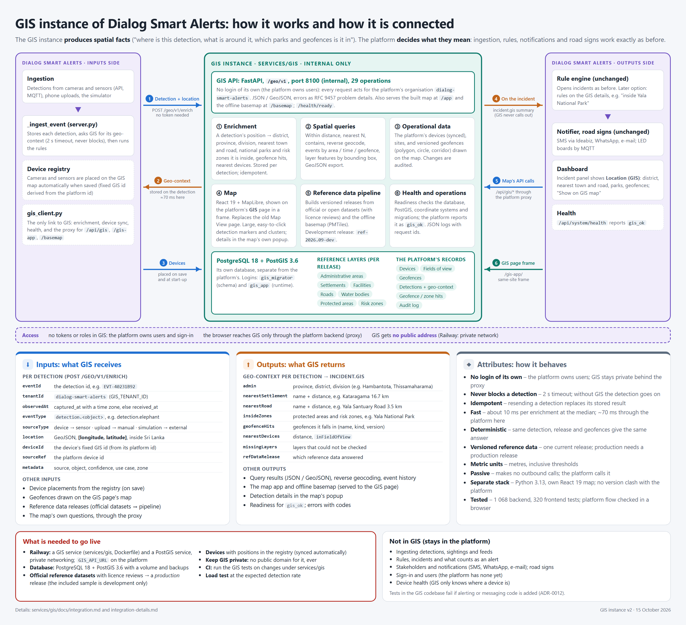

# The GIS instance in Dialog Smart Alerts

This is the short version. Commands, settings and deployment steps are in
[integration-details.md](integration-details.md).



## 1. What GIS does, in one sentence

The platform sends GIS each detection's position, and GIS answers **where it is and what is around it**.
The platform's rules and notifications stay exactly as they are.

| GIS does | The platform does (unchanged) |
|---|---|
| Says which district, province and division a detection is in | Takes in detections (API, MQTT, simulator, phone upload) |
| Finds the nearest town, road and devices | Runs the rules and opens incidents |
| Says if it is inside a national park, risk zone or geofence | Notifies stakeholders, lights road signs |
| Shows everything on the **GIS** page of the dashboard | Owns users, sign-in and the dashboard |

GIS never sends alerts or messages, and never calls the platform. The platform always calls GIS.

## 2. How they are connected

```
Browser ──► platform (FastAPI, :8000) ── the only public entry point
              ├─ GIS page (/gis) shows the GIS map in a frame (/gis-app/)
              ├─ /api/gis/*, /gis-app/*, /basemap/*  ──proxy──►  GIS service (:8100, internal)
              ├─ every detection  ──enrich──►  GIS          → stored on the event, shown on the incident
              └─ every device     ──placed──►  GIS          → shown on the GIS map
                                                GIS service ──► its own database (PostgreSQL + PostGIS)
```

1. **Detections → GIS.** Each detection with a position is sent to GIS. The answer (district, nearest town
   and road, parks, geofences, nearby devices) is stored on the event, and the incident panel shows it under
   **Location (GIS)**. If GIS is slow or down, the detection goes through normally after 2 seconds,
   without GIS details.
2. **Devices → GIS.** Devices in the registry appear on the GIS map, and move when they are edited.
3. **The GIS page.** The dashboard's **GIS** page shows the GIS map (it replaces the old Map View page).
   Clicking a detection shows its details in the map's own popup; **Show on GIS map** on an incident opens
   the map there.

## 3. What changed

- **GIS (`services/gis`):**
  - It has no login of its own: the platform owns users, so GIS checks no tokens.
  - It serves its map and offline basemap itself.
  - Version 1, with its own login, is kept outside the repository.
- **Platform:**
  - One new file, `backend/gis_client.py`.
  - A few lines in `server.py`.
  - The GIS page, which replaces the Map View page (old `/map` links go to `/gis`).
  - A **Location (GIS)** section on the incident panel.
  - `httpx` added to the requirements.
  - Nothing else changed: rules, notifications, signs and MQTT work as before.

## 4. Running it

```powershell
cd services\gis; .\setup.ps1          # the GIS service: database, API on :8100 (first time: several minutes)
cd ..\..\backend; python server.py    # the platform, as before (GIS_API_URL defaults to http://localhost:8100)
npm run dev                           # the dashboard on :5173 -> open the GIS page
```

On Railway, GIS is a second service, built from `services/gis`, with its own PostGIS database. The platform
reaches it on the private network. See [integration-details.md](integration-details.md#5-railway).

## 5. Before production

- **Official map data.** The included map data is a development sample (OpenStreetMap, made-up risk zones).
- **Keep GIS private.** It has no login, so it must not get a public address; the platform's proxy is the
  way in.
- **Load test** at the expected number of detections.
